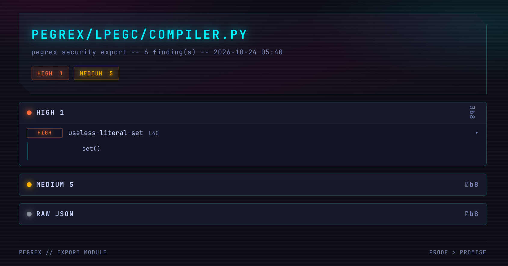

# PegRex v1.1.0





**A self-contained symbolic-execution and syntactic-analysis engine** that
turns source code in 22 registered languages into mathematical specifications for AI
agents — and *refuses loudly* rather than guessing. Every claim is PROVED,
REFUTED by confirmed evidence, or explicitly UNKNOWN with its coverage gaps.

`parse -> solve/prove -> abstract -> execute -> emit/verify -> repair -> serve`

The canonical frontend registry owns every language ID, extension, parser and version, coordinate conversion, normalizer, error policy, CFG adapter, lowering level, contract feature set, security pack, maturity level, and known unsupported case. Parsing never implies contract or proof support.

**PegRex** is a self-contained symbolic-execution and syntactic-analysis engine for AI agents — **parse, solve, prove, abstract, execute, emit, verify, repair, serve**. Version 1.1.0 adds a non-throwing CoreEngine dispatch boundary, a workspace-confined Tools API v2, structured CLI errors, stronger source and counterexample provenance, and production hardening for scanner, modernization, insurance, and certificate paths. The repository audits itself through fresh SELF/HEALTH evidence and machine-checkable finding dispositions.

Run `python pegrex.py soundness` for the complete machine-readable plugin manifest and trust policy, or add `--language ID` for one frontend. The same report is available through `CoreEngine.soundness()` and the stdio service's `soundness` method. Native legacy and domain-specific analyzers are registered through the same manifest; the split `pegrex/lpegc/` compiler handles the bundled grammar-text formats. 

It speaks fifteen-plus languages, exposes sixty-five commands, 331 unit tests, 17 agent skills — and audits itself in public via a regenerated SELF.md that CI refuses to let go stale.

**Tree-sitter frontends (full CST → contracts)**
 - Nine bindings: Python, Go, Rust, Julia, Kotlin, Zig, Solidity, Vyper, JavaScript, TypeScript, AssemblyScript. 
 - The bridge's language map also routes lua and c (those resolve via the tree_sitter_language_pack when installed 

**Native legacy frontends (certified, no grammar needed)** hand-built parsers producing the same contract tuples as every other language, with machine-checked cross-language equivalence (a COBOL absval and a Fortran absval verify as identical). An offline tree-sitter mock layer makes these parse through the standard bridge too.

 - COBOL (.cob/.cbl/.cobol)
 - Fortran (.f90/.f95/.f03/.f08)

**Domain-specific languages**
 - SQL (SELECT subset with OR groups — SQL↔ORM equivalence checking)
 - Circom (ZK circuits — under-constrained signal auditing)

**Grammar-text formats (the LPegRex .gram compiler)**
 - JSON, C11, CSV, URL, INI, S-expressions, Go-subset, MIR, MLIR, Vyper-subset, agent grammars — compiled by the split pegrex/lpegc/ compiler into executable pattern trees.


## The Security Engine

**Defense in depth, each layer certified with negative controls that must refuse:**

    · SAST core — 655 active deduplicated pattern rules + 86 taint rules; exact-duplicate removal with upstream provenance; 27 context-insufficient conversions retained as disabled coverage records with reasons; sequential directory audits; SARIF 2.1.0/Code Scanning evidence with CWE/OWASP mappings and justified suppressions;
    · Taint, three-valued — every flow is safe, vulnerable, or UNKNOWN, with concrete source/sink evidence; never "no path found" as "verified.";
    · Reproducible scans — exact rule-catalog and source SHA-256 identities, installed parser versions, and explicit OSV snapshots; missing offline vulnerability data is UNKNOWN, never clean;
    · Advanced dataflow — SSA value identities, CFG fixed-point taint with path-sensitive sanitizers, cross-module summaries with recursion widening, context-sensitive sinks, and secret-flow categories for logs, telemetry, URLs, process arguments, and network sinks;
    · Deployment and organizational policy — declarative policy-as-code plus IAM, Kubernetes, Terraform-subset, and Dockerfile checks compared with application assumptions;
    · Reproducible evidence and isolation — deterministic offline audit ZIP bundles with hashes/tool versions/configuration/coverage; resource-limited argv-only workers parse hostile source and grammars without executing source;
    · ZK auditing — under-constrained Circom detection; '<\--' without '===' and unconstrained outputs are named;
    · Autonomous bug bounty — discover the guard, solve a concrete payload by Fourier-Motzkin, delta-debug the minimal witness, repair under a payload-killed verifier (an unguarded sink post-fix is worse, never "fixed") — and the whole loop is policy-gated before execution by the agent safety harness (argv-only execution, canonical executable/path identities, default-deny, deny precedence, first refusal stops the plan);
    · Compliance as code — GDPR findings that name the flow; SOC2 control presence; legal deadlines without a base date are "not evaluable," never fake-future;
    · Infrastructure verification — Zelkova-style can (principal, action, resource) with explicit-deny precedence; wildcard-admin and public-bucket findings;
    · Insurance oracle — deterministic heuristic premiums only for proved bounded risk; UNKNOWN risk has no numeric premium; signed quotes require an explicit non-empty HMAC key;
    · Distribution trust — signed manifests, SLSA attestations; the Sigstore seam refuses offline rather than pretend publication.

## The (A)Schema & Specification Engine

**The contract is the atom: every function becomes path contracts — (constraints) → result — and every other engine consumes or produces them.**

    · specgen — the AI spec schema (multi-opus): specifications as agent-consumable data, not prose;
    · modernize / py2cobol — legacy modernization in both directions with machine-checked contract identity across language spaces;
    · apicontract — an OpenAPI schema is the shared contract; the Python server and Go client are each checked against it; drift is named, never smoothed;
    · refine — # requires:/# ensures: comments discharged per path; undischarged is reported, never assumed;
    · specmine — Daikon-style candidates classified proven / likely / dropped; mining proposes, never asserts;
    · nlspec → antihalluc — English claims become formal candidates, then the anti-hallucination compiler emits code from the contract IR and verifies it: a false sentence ships nothing;
    · sqlrel — SQL and ORM agree only when proven equivalent; OR-conditions compare group-wise; sampled production query logs carry their sample size on every verdict.


 -  **ir.py lower_condition():** *any condition → typed IR; loud CondError, never a silent regex guess*
 -  **linsolve.py:** *LinearBackend.learn/entails*


## Core Engine and Tools API v2

`CoreEngine.execute(operation, arguments)` is the production dispatch boundary. It returns an `OperationResult` for `parse`, `contracts`, `contracts_file`, `audit`, `call_graph`, `verify_patch`, `capabilities`, and `soundness`; invalid envelopes and implementation failures become structured `status: "error"`, `verdict: "unknown"` results. Direct historical methods retain their exception behavior.

`pegrex.toolsapi` adds a lazy, manifest-driven API with JSON-shaped argument validation, workspace confinement (including symlink escapes), source SHA-256 provenance, and versioned evidence envelopes. It does not execute shell commands or mutate the real workspace.

```python
from pegrex.core import get_engine
from pegrex.toolsapi import invoke, list_tools

result = get_engine().execute("parse", {"source": "return 1", "language": "python"})
manifest = list_tools()
evidence = invoke("core.contracts_file", {"path": "example.py"}, workspace=".")
```

Equivalent CLI entry points:

```
python pegrex.py engine list
python pegrex.py engine parse --input '{"source":"return 1","language":"python"}'
python pegrex.py tools
python pegrex.py tools --name core.contracts_file
python pegrex.py tool core.contracts_file --workspace . --input '{"path":"example.py"}'
```

Operation errors exit 1. `--fail-on-unknown` exits 2 for UNKNOWN or partial evidence. A completed REFUTED analysis is not, by itself, a process failure.

## Installation and validation

```
python -m pip install .
python -m pip install -r requirements-ci.txt   # exact CI test environment
python run_tests.py
python tools/selfhost.py --check
python tools/health_report.py --check
python tools/build_skills.py --check
python tools/grammar_lint.py examples/*.gram
```

Optional parser, solver, and evidence dependencies are declared in `pyproject.toml`. Missing capabilities remain explicit refusals; they are not replaced with silent semantic fallbacks.

## Library

```
from pegrex import facade          # the whole surface in one import
out = facade.verify_patch("a.py", "b.py")   # proof or counterexample

from pegrex import AnalysisSession
session = AnalysisSession(source, "python", max_paths=10_000)
session.tree                       # one normalized parse, shared lazily
session.call_graph                 # call graph over that tree
session.contracts()                # bounded contracts over the same tree
session.complexity                 # cognitive complexity over the same tree
session.security                   # SAST + taint over the same tree
report = session.analyze()         # per-analyzer ok / resource UNKNOWN
```

Caches use content + parser/analyzer versions + normalized configuration. Immutable IR nodes are hash-consed; canonicalization, linearization, and implication probes are memoized. Path explosion and solver/per-file budget exhaustion are explicit UNKNOWNs, never partial proofs.

## CLI

```
python pegrex.py index --out <out> <dir>   # repo arch index
python pegrex.py audit FILE                # deduplicated audit; report-only by default
python pegrex.py audit FILE --fail-on high --fail-on-unknown  # opt-in CI gates
python pegrex.py audit FILE --sarif --out results.sarif       # GitHub Code Scanning
python pegrex.py spec --dir <PATH>         # AI spec schema (multi-opus)
python pegrex.py contracts FILE            # path contracts
python pegrex.py cognitive <file>          # cognitive complexity + refactor plans
python pegrex.py rosetta <spec>  N-        # N-way cross-language equivalence (semantic diff)
python pegrex.py modernize <file>          # legacy (COBOL/Fortran) -> target with equivalence certificate
python pegrex.py roundtrip --print-cobol   # Python -> COBOL round-trip with contract identity
python pegrex.py insure <file> --key '<explicit-key>'  # signed bounded-risk quote
python pegrex.py insure --verify <file>    # verify a signed quote
python pegrex.py rules --json              # registry-selected rule catalog summary
python pegrex.py soundness [--language ID] # frontend plugins, limits, and trust policy
python pegrex.py osvscan LOCKFILE --offline --osv-snapshot osv.json  # reproducible OSV scan
python pegrex.py cisec <file>              # CI/CD pipeline security analysis
python pegrex.py verify-patch              # proof or counterexample for two sources
python pegrex.py bundle <PATH> <source>    # portable verification bundle
python pegrex.py compile-nl <text> <file>  # anti-hallucination compiler: NL -> code -> proof
python pegrex.py autopwn                   # policy-gated discover/solve/repair loop
python pegrex.py bounty  <file>            # discover/solve/minimize a PoC for a sink
python pegrex.py verify-patch BEFORE AFTER # proof or counterexample
python pegrex.py export FILE --format sarif --out results.sarif  # json/csv/html/sarif
python pegrex.py compress                  # LLM context compression
python pegrex.py explain <file>            # explain a function as math
python pegrex.py callgraph --dir <PATH>    # function-call graph (DOT/ASCII)
python pegrex.py callgraph --dir <PATH> --jobs 4 --benchmark  # optional spawn workers + overhead report
python pegrex.py coverage --dir <PATH>     # path coverage overlay + gaps
python pegrex.py caps <file>               # infer capabilities + sandbox policy
python pegrex.py diff A B                  # semantic diff
python pegrex.py budget --dir <PATH>       # complexity budget gate
python pegrex.py emit FILE [--run]         # certified code from contracts
python pegrex.py check FILE                # discharge requires/ensures comments
python pegrex.py compliance                # GDPR data-flow + optional SOC2 control audit
python pegrex.py harness-check <plan>      # check an agent plan JSON against the safety policy
python pegrex.py strategy <file>           # Hypothesis strategies from path constraints
python pegrex.py mine FILE                 # mine likely invariants
python pegrex.py concolic <file>           # trace a run and flip a branch
python pegrex.py probpath <spec>           # path frequencies + priorities from traces
python pegrex.py mlcheck: <spec>           # quant/prune equivalence from a JSON spec
python pegrex.py rank "i <= n" --delta i=1 # termination ranking
python pegrex.py transpile FILE python     # certified Python target
python pegrex.py bench                     # agent-edit benchmark
python pegrex.py tests --lcov <lcov> <src> # synthesize tests from coverage gaps
python pegrex.py serve|acp|mcp|a2a|lsp     # protocol endpoints
```

### Reproducible security reports

`audit --json` returns `pegrex.security-scan.v1`; `audit --sarif` returns SARIF 2.1.0 with stable rule IDs, confidence, CWE/OWASP properties, source/sink code flows, fingerprints, and scan provenance. Upload `.sarif` output with GitHub's `codeql-action/upload-sarif` action. Suppressions stay visible in both formats and require a justification on the finding line or the preceding line:

```
# pegrex:ignore RULE-ID -- reviewer rationale and tracking ticket
```

Unjustified directives do not suppress findings or CI gates. Shell actions in harness plans must use `{"tool":"shell","argv":["pytest","-q"]}`; raw command strings, shell operators, expansion, absolute/traversal/symlink paths, launchers, and Unicode lookalikes are refused. `osvscan --offline` uses only the supplied snapshot/cache, and missing entries produce `status: "unknown"`. Use `--snapshot-out FILE` to capture a complete online query set for later offline reproduction.

There are no built-in demo HMAC secrets. `attest`, insurance quote generation, and invariant-market publish/import require explicit non-empty keys. `concolic` and certificate `check` commands intentionally execute operator-selected local code; they are explicit execution interfaces, not safe parsers for untrusted files. Loop-summary evidence and concolic branch observation use restricted, side-effect-free expression evaluation and never `eval`/`exec` the analyzed expression or loop source.

## The one rule

Every engine surface follows the same discipline: **prove it, or refuse loudly**. 
Undischarged contracts are reported, never assumed; opaque
fragments degrade to `unknown`/`maybe`; certificates carry negative controls
that must refuse; `verify_patch` returns a counterexample, not a shrug.

## Repository layout

```
pegrex/        engine (pegrex/lpegc/ holds the LPegRex
                   compiler split: parser.py / compiler.py / diagnostics.py)
tests/         historical, compatibility, adversarial, and hardening suites
examples/      .gram formats + walkthroughs
tools/         repo-facing scripts (secaudit, mkspec, ...)
skills/        agent SKILL packs
docs/          README.md, HEALTH.md, SELF.md (the self-audit)
```

## The self-hosting proof

`python tools/selfhost.py` regenerates `docs/SELF.md` -- the twin, cognitive-complexity, and contract reports of pegrex/ *by pegrex itself* (regenerated function totals and published refusals). `python tools/build_skills.py` reproducibly rebuilds `pegrex-skills.tar.gz`; both generators support `--check`. See `docs/PUBLIC_CONTRACTS.md` for stable API, CLI, service, and result contracts.


## What it does

Given a function, pegrex enumerates its path contracts —
`(constraints) -> result` pairs — then lets you *do* things with them:

| capability | module
|---|---
| typed expression IR (the m76 seam: `a+1 < b`, calls, fields) | `pegrex/ir.py`
| Fourier-Motzkin multi-var linear arithmetic + entailment | `pegrex/linsolve.py`
| differential solver testing (bounds vs FM + filed findings)
| proof-carrying certificates (linear-combination witnesses) | `pegrex/proofs.py`
| symbolic memory: bounds + aliasing verdicts | `pegrex/memory.py`
| Houdini loop invariants + single-fixpoint property checking (not full IC3/PDR: no frame sequence, no CTI/propagation) | `invariants.py` / `pdr.py`
| octagon domain (closure, widening, FM-differential) | `pegrex/octagon.py`
| termination ranking functions | `pegrex/rank.py`
| per-language integer-overflow semantics (Rust/C/Solidity) | `pegrex/overflow.py`
| **certified transpilation**: contract IR -> real Python + proof | `emitter.py`, `transpiler.py`
| concolic execution (trace, flip branches, confirm) | `pegrex/concolic.py`
| Hypothesis strategies from path constraints | `strategies.py`
| refinement contracts as comments (Dafny-lite) | `refine.py`
| spec mining (Daikon-style, classified proven/likely/dropped) | `specmine.py`
| NL -> spec -> proof (claims proven, dropped, or refused) | `nlspec.py`
| CEGIS repair loop + integrated evidence pipeline | `cegis.py`, `chain.py`
| semantic diff / `verify_patch` (proof or counterexample) | `semantics.py`
| e-graphs with oracle-refused rewriting + node-var patterns | `eggx.py`
| SQL <-> ORM equivalence | `sqlrel.py`
| bytecode VM (loops with ranked termination) | `vm.py`
| veritesting state-merging via FM projection | `veritest.py`
| agent endpoints: A2A (JSON-lines) + LSP (hover contracts) | `a2a.py`, `lsp.py`
| context compression for LLM calls | `compress.py`
| deterministic agent benchmark + verified-pair exporter | `benchmark.py`, `trainer.py`
| signed skill marketplace (HMAC manifests) | `marketplace.py`
| cross-language API contracts (OpenAPI schema) | `apicontract.py`
| **COBOL frontend** (native contracts, refinement, verify_patch) | `cobolfront.py`
| **Fortran frontend** (result convention, cross-language equivalence) | `fortranfront.py`
| offline tree-sitter mocks + vendor seam (COBOL/Fortran) | `tsmock.py`
| legacy modernization factory (COBOL/Fortran -> Python + equivalence certificate) | `modernize.py`
| three-valued results everywhere (proved/refuted/unknown, machine-audited) | `tv.py`
| ZK-circuit auditing (under-constrained Circom) | `zk.py`
| IaC verification, Zelkova-style (IAM can() + findings) | `iac.py`
| AI safety harness (agent plans refused pre-execution) | `harness.py`
| bug-bounty agent (discover -> solve -> minimize PoC) | `bounty.py`
| GDPR/SOC2 compliance as code (taint findings) | `compliance.py`
| ML graph verification (quant/prune equivalence, bounded) | `mlgraph.py`
| digital twin codebase graph (NL via path math) | `twin.py`
| probabilistic path analysis (trace frequencies rank tests) | `probpath.py`
| SLSA-style attestations (offline-honest Sigstore seam) | `slsa.py`
| time-bounded verify-or-refuse API (deadline -> unknown) | `vapi.py`
| cognitive complexity for Python (complexipy-faithful reimplementation) | `cognitive.py`
| twin + cognitive queries ("which functions are over budget?") | `twin.py`
| cognitive-budget CI gate (`--fail-on-over`) | `cli.py`
| unified taint/facts/twin graph, one-traversal queries | `graph.py`
| autopwn: policy-gated discover -> solve -> repair loop | `autopwn.py`
| probabilistic deadline allocation (verdicts carry coverage) | `priorverify.py`
| round-trip modernization (Python -> COBOL, contract identity) | `py2cobol.py`
| legal-deadline CI artifact (honest base-date semantics) | `legalci.py`
| SQL OR-conditions + sampled migration equivalence | `sqlrel.py`
| **anti-hallucination compiler** (NL -> code -> proof; refuses) | `antihalluc.py`
| **org twin** (teams x compliance x complexity) | `orgtwin.py`
| hybrid RAG: local embeddings + BM25, offline (served path -- rag.py's chunking delegates scoring here) | `hybridrag.py`
| adversarial self-play: bounty fuzzes the harness policy, bypasses become permanent negative controls | `selfplay.py`
| e-graph performance oracle: ranks oracle-proven-equivalent expressions by op-count, refuses what it can't independently connect | `perfgolf.py`
| natural-language contract chat for PR review: proven / refuted-with-witness / unknown PR-comment replies | `prchat.py`
| self-certifying package registry: specmine-proven properties signed + tracked; regressions refused by name | `registry.py`
| continuity: verify the engine against its own prior version, function-by-function, proof or named counterexample | `continuity.py`

## Mission

 - Turn source code into mathematical specifications that AI agents can trust -- and make "trust" mean something provable.

## One-liner

 - parse -> solve/prove -> abstract -> execute -> emit/verify -> repair -> serve -> audit itself.

## Invariants (the whole law)

1. - Three-valued everywhere: PROVED, REFUTED, UNKNOWN. Unknown is first-class; "no path found" is never "verified".
2. - Refusal is a feature: anything outside the certified fragment is REFUSED loudly, never guessed.
3. - Negative controls are sacred: weakening one scores minus infinity (golfbench), and CI fails on it.
4. - The engine audits itself: docs/SELF.md is regenerated by tools/selfhost.py and --check fails the build when it goes stale.
5. - Offline honesty: absent toolchains (z3, xxhash, Go, Sigstore) are certified refusals, not silent fallbacks.


## Genesis: Born from LPegRex

  *- a Python rewrite of Sérgio Medeiros's PEG-based regex extension to LPeg/Lua: a packrat engine with error labels and a grammar-text compiler:* **The seed discipline — parse faithfully, refuse ambiguity — became the spine of everything after.**

 **-  Reimplemented: with local philosophy**
      · CEGIS;
      · octagons;
      · SLSA attestation;
      · KLEE-lite memory;
      · Houdini and IC3/PDR frames;
      · complexipy's cognitive complexity;
      · a Z3-class QF_LIA solver by Fourier-Motzkin;
      · DRAT-style proof certificates;
      · Zelkova-style IAM;
      · Daikon-style mining;
      · Dafny-lite contracts;
      · egg-style e-graphs with oracle-refused rewrites;
      · DeepPoly-lite bounds for quantized neural graphs;
      · offline tree-sitter conformance mocks.

**Became: the engine that audits everything — and audits itself**
   · a modernization factory (COBOL/Fortran → certified Python, both directions);
   · an anti-hallucination compiler (English → provably-correct code);
   · an insurance oracle pricing from verified overflow risk.


## Status notes (honest)

- **transpiler / modernize**: only independently verified Python emission is published as `code`; generated but unverified output is `candidate_code`. Unsupported targets, overflow, budget exhaustion, and incomplete path enumeration remain UNKNOWN with no production stub.
- **language maturity**: registered analysis frontends are `stable`, `parse-only`, or `domain-specific`; stable does not mean complete language semantics. Run `soundness` for exact unsupported constructs, including async/concurrency, unsafe Rust, macros, reentrancy, and cross-call behavior.
- **codegen.emit_rust_stub**: portable data/stub generation only; it is not a verified Rust translation certificate.
- **mini_llm**: deterministic zero-dependency fallback; use `hybridrag` for retrieval. No model output is promoted to proof without independent verification.
- **scanner catalog**: disabled conversions remain visible with `disabled_reason` and coverage provenance. They are not silently suppressed findings; active findings still require human triage, and HEALTH maintenance tasks are not confirmed vulnerabilities.
